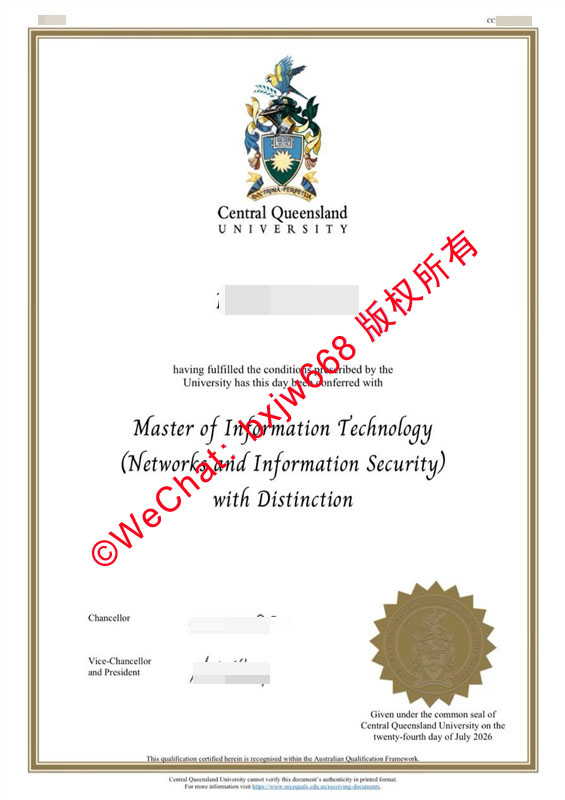

# 澳大利亚中央昆士兰毕业证样式范本（cqu Diploma)参照比对

在当下全球化留学的背景下，澳大利亚的高等教育文凭在国际上享有极高的认可度。其中，**中央昆士兰大学（CQUniversity，简称 CQU）** 作为澳洲最具活力和包容性的综合性公立大学之一，其颁发的学位证书不仅是毕业生学术成就的结晶，更是进入全球高端职场的敲门砖。 

为了帮助广大学子、留学生服务机构以及人事部门更加准确地了解和识别澳洲高校的文凭，本文将围绕“**澳大利亚中央昆士兰毕业证样式范本（cqu Diploma)参照比对**”这一主题，从最新版证书的排版布局、防伪视觉元素、专业排版细节等多维度进行深度剖析，为您提供一份极具参考价值的官方权威实物解析指南。

## 一、 澳洲CQU毕业证设计演变与排版框架分析
在进行精细化的参照比对之前，我们首先需要理解中央昆士兰大学毕业证书的整体视觉逻辑。澳洲高校在学位证书的设计上向来严谨，既保留了英联邦传统的典雅庄重，又融入了现代防伪印刷技术。

### 1. 经典双边框长方形版面
从官方最新发布的范本（如2026年7月最新批次的证书）来看，CQU 毕业证采用标准的竖版大A4尺寸。其最外层由一条精细的深色线框和一条稍宽的金色/棕色内饰边框共同构成双层边框框架。这种设计在视觉上能够赋予证书极强的仪式感与神圣感。

### 2. 核心信息轴线对齐
证书的所有文字、校徽、印章全部采用**绝对居中对齐（Center Alignment）**的轴线排版。从顶部的彩色校徽，到中部的毕业生姓名、授予学位名称，再到最底部的校长签名与官方钢印，视觉重心保持绝对一致。这种结构不仅在美学上非常平衡，也是判定证书排版是否合规的首要基础。

## 二、 核心视觉元素深度剖析（CQU学位证防伪）
一份真正的 CQU 毕业证书（Degree Certificate），其核心价值蕴含在每一个高度定制化的视觉元素中。通过以下几个关键部分的参照比对，能够清晰辨别其真实性与专业性。

### 1. 顶部彩色官方校徽（University Crest）
位于证书正上方最核心位置的是中央昆士兰大学的正式盾徽。
* **色彩呈现**：校徽由蓝、黄、白等多种高饱和度色彩复合而成，顶部有一只展翅的澳洲本土雀鸟（寓意志向高远），盾牌中心是一轮金色的太阳，下方带有拉丁文校训绶带。
* **比对要点**：真正的校徽印刷边缘极其清晰，雀鸟羽毛与太阳光芒的线条分明，不会出现色彩溢出、重影或模糊不清的现象。在校徽正下方，紧接着两行大写的学校英文名称：“Central Queensland UNIVERSITY”。

### 2. 字体艺术与文本分层（Typography）
CQU 证书在字体的选择和字号搭配上非常讲究，形成了清晰的视觉层级：
* **学衔主体**：授予的学位名称（例如：*Master of Information Technology (Networks and Information Security)*） [Master of Information Technology (Networks and Information Security)] 通常会采用优雅且具有历史底蕴的**衬线英文字体（Serif Font）**，并进行加粗或斜体处理，以彰显学术的庄重。
* **荣誉后缀**：若毕业生表现优异，学位下方会自成一行标注荣誉级别，如“*with Distinction*”（卓越），字体流畅度极高。

### 3. 右下角金色金属光泽齿轮钢印（The Common Seal）
这是整张毕业证上最引人注目的防伪与认证标志。
* **位置与形态**：位于证书右下角，为一个大尺寸的金色齿轮状（放射状多角）特殊印章。
* **内部纹理**：印章内部同样压印有中央昆士兰大学的完整盾徽图案，并环绕有“Central Queensland University”的官方字样。
* **签发日期关联**：在金色钢印的右侧或下方，会明确用英文大写或特定格式标注具体的签发时间，例如：“*Given under the common seal of Central Queensland University on the twenty-fourth day of July 2026*”。

## 三、 签字与底部认证细节比对（澳洲大学毕业证模板）
除了显性的校徽 and 钢印，证书底部的签名栏以及框架底部的声明条款，往往是衡量一份文凭样式是否真正做到“一比一还原官方标准”的关键。

### 1. 关键核心高管的双重签名
CQU 的毕业证书底部通常拥有两个关键的签名位，分别代表学校最高管理层与学术层的双重背书：
* **Chancellor（校监/大学董事长）**：签名位于左下角上方。
* **Vice-Chancellor and President（校长兼首席执行官）**：签名位于左下角下方 [Master of Information Technology (Networks and Information Security)]。
* **参照细节**：真正的签名具有极强的个人手写书法张力，线条有粗细交替的墨迹质感，非普通的印刷体或生硬的描摹线条所能比拟。

### 2. 底部澳大利亚学历资格框架（AQF）认证说明
在双层边框的底端内部，有一行非常微小但至关重要的声明文本：
> *"This qualification certified herein is recognised within the Australian Qualifications Framework."*
（本证书所证明的资质在澳大利亚学历资格框架内获得认可。）

这行字表明了该文凭在澳洲全境及国际上的法律效力。紧贴底边框外侧，还印有学校的版权、数字证书查询网址（如 My eQuals 平台 [Master of Information Technology (Networks and Information Security)] 相关说明）等防伪查验指南。

## 四、 留学生如何确保 cqu Diploma 的真实效力与国内认证？
了解毕业证的范本样式和参照比对，最终目的是为了确保所获学历能够顺利通过权威机构的检验，转化为职场竞争优势。

1. **核对个人与专业信息**：在收到毕业证纸质原件时，务必对照自己的护照拼音，核对姓名拼写、出生日期以及修读专业（含方向，如 Networks and Information Security）是否完全一致。
2. **利用 My eQuals 数字平台**：澳大利亚高校目前普遍启用 **My eQuals 官方数字证书系统** [Master's Degree from CQUniversity]。毕业生可以通过官方链接直接获取带有数字签名的加密 PDF 毕业证及成绩单。这是国际名企和境外机构进行“秒级验证”最信赖的途径。
3. **及时申请中国教育部留服认证**：中国留学生在学成归国后，应第一时间登录中国教育部留学服务中心（CSCSE）官网，提交毕业证、成绩单及护照等材料申请海外学历学位认证。只要您的纸质证书符合本文上述的所有排版、校徽、印章和 AQF 标准，且就读期间满足学时与出入境要求，即可顺利斩获认证。

## 总结
通过对**澳大利亚中央昆士兰毕业证样式范本（cqu Diploma)** 的深度比对我们可以发现，一幅合格、正规的 CQU 文凭不仅要在纸张质感、校徽色彩上做到完美重现，更在右下角的金色钢印纹理、底部双高管手工签名以及微缩 AQF 条款等细节处设立了极高的门槛。希望本篇参照比对指南能为广大留学生在学历验证、报告比对和成果展示时提供清晰、可靠的视觉与逻辑依据。

